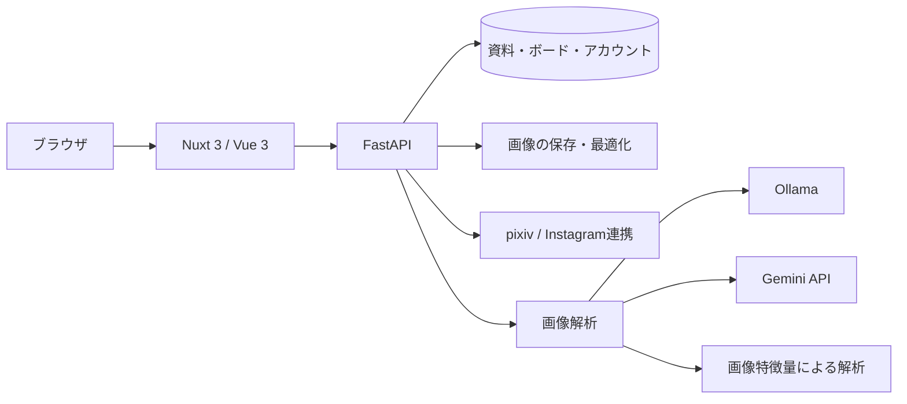

<p align="center">
  
</p>

<h1 align="center">RefLens.io（レフレンズ）</h1>

<p align="center">
  <strong>資料探しから構想まで、これひとつ。</strong><br>
  資料を探す・集める・見比べる。その流れをひとつにつなぎ、作品の構想を支えるリファレンス管理アプリ。
</p>

<p align="center">
  <a href="https://art.wawa-app.me/RefLens.io/"><strong>デモサイトを開く →</strong></a>
  &nbsp; · &nbsp;
  <a href="#使い方">使い方</a>
  &nbsp; · &nbsp;
  <a href="#技術構成">技術構成</a>
  &nbsp; · &nbsp;
  <a href="#aiポリシー">AIの扱い</a>
</p>

> **公開デモについて**：Cloudflare Tunnelで配信しています。サーバー停止中はアクセスできません。保存・取り込みなどの操作にはログインが必要です。
>
> **このリポジトリは作品紹介用です。** オープンソースではありません。複製・改変・再配布・再利用などの条件は [ライセンス規約](LICENSE.md) をご確認ください。

---

## 01 — 探して終わらない。アイデアを形にする資料庫。

作品のイメージを練るとき、資料探しはブラウザ、保存はフォルダ、比較は別のツール。作業が分かれるほど、集めたインスピレーションを構想へつなげにくくなります。

- 保存した画像が増えるほど、必要な1枚を見つけにくくなる。
- ポーズ・衣装・光の資料を見比べるために、画面を何度も切り替える。
- 「この絵の何が参考になるか」を整理するのに手間がかかる。

**RefLens.ioは、資料探しから構想までをひとつの場所で進めるためのアプリです。** pixivやWebで見つけた画像を保存し、特徴から探し直し、無限キャンバスで比較する。イラストレーターやコンセプトアーティストが、ポーズ・配色・世界観のイメージを練る作業を支えます。

---

## 02 — 探す。集める。構想する。

| 探す | 集める | 構想する |
| --- | --- | --- |
| pixivの作品や、保存した資料をキーワード・タグで探す。 | WebのURL、手元の画像、pixiv作品を資料庫へまとめる。 | 無限キャンバスで資料を並べ、ポーズ・配色・構図を見比べる。 |
| **イメージの手がかりを見つける。** | **気になった資料を、あとから使える形へ。** | **資料の組み合わせから、描きたい方向を練る。** |

<a id="使い方"></a>

### 3つの画面で、資料探しから構想まで

| 画面 | 役割 | こんなときに |
| --- | --- | --- |
| **View** — 探す | pixivのおすすめ・ランキング・キーワード検索・作品詳細 | 作品のイメージにつながる資料を探したい |
| **Manager** — 集める | 資料の保存、フォルダ整理、検索、プレビュー | 気になる資料をまとめ、必要なときに取り出したい |
| **Canvas** — 構想する | 画像の配置、拡大縮小、回転、反転、整列 | 資料を見比べながら、構図や配色の方向を決めたい |

**利用例：キャラクターを描くとき**

1. **探す**：描きたいキャラクターのポーズ、衣装、ライティングの参考画像を探す。
2. **集める**：候補を資料庫へ保存し、フォルダやタグで整理する。
3. **構想する**：キャンバスで資料を並べ、ポーズ・配色・シルエットを比べながら、描きたいイメージを練る。

ログイン前はデモを閲覧でき、ログインすると自分の資料を保存・整理できます。外部サービスの利用には、別途連携設定が必要な場合があります。

---

## 03 — 描く人の作業に合わせた機能

### 自由に広げられる、無限キャンバス

PureRefのように、画像を自由に並べて参照できます。ポーズ・衣装・背景の候補をひとつの画面に広げ、組み合わせを見ながら構想を練れます。ドラッグ移動・リサイズ・回転に加え、グリッドや縦横の整列で資料をまとめられます。

**左右反転でシルエットを確認。グレースケールで明暗を比較。** 見た目の調整を、作品研究につなげます。

<details>
<summary><strong>キャンバスの操作を詳しく見る</strong></summary>

- パン・ズーム、画像の移動・四隅リサイズ・自由回転・15度スナップ
- 画像ファイルのドラッグ＆ドロップ、クリップボードからの貼り付け
- グリッド整列・水平整列・垂直整列
- 複数選択、Undo / Redo、左右・上下反転、グレースケール表示
- ピンチズーム・2本指パンなどのタッチ操作

| キー | 操作 |
| --- | --- |
| `Space` + ドラッグ / 中クリックでドラッグ | キャンバスを移動 |
| `H` / `V` | 左右反転 / 上下反転 |
| `G` | グレースケール表示を切り替え |
| `Delete` / `Backspace` | 選択した資料を削除 |
| `Ctrl/Cmd` + `A` | 全選択 |
| `Ctrl/Cmd` + `Z` | 元に戻す |
| `Ctrl` + `Y` / `Cmd` + `Shift` + `Z` | やり直す |
| `Ctrl/Cmd` + `0` | 表示倍率を100%に戻す |
| `?` / `F1` | ショートカット一覧を開く |

</details>

### 画像の「参考になるポイント」を読み解く

AIが画像の特徴を読み取り、構図・光・ポーズ・衣装・配色を整理します。解析結果はタグやカラーパレットとして、資料の検索・比較にも使えます。

| 見るポイント | 参考にできること |
| --- | --- |
| **構図** | 視点、画面内の配置、視線の流れ |
| **ライティング** | 光の方向、逆光、明暗の対比 |
| **ポーズ** | 重心、身体の流れ、遠近感 |
| **衣装** | 素材感、シワの方向や特徴 |
| **配色** | 主要色のパレット、色コードのコピー |

解析結果は参考情報であり、誤ることがあります。自動AIタグ付けはアカウント設定から切り替えられます。送信先や解析の扱いは [AIポリシー](#aiポリシー) を参照してください。

### pixivの作品探しから、資料の保存まで

おすすめ、デイリーランキング、キーワード検索、フォロー中の作品、ブックマークを閲覧できます。作品の複数ページをまとめて取り込み、資料庫への保存やキャンバスへの配置につなげます。

- 同じ作品・ページを再利用して重複登録を抑制
- pixiv由来のタグを資料の検索に活用
- Instagram取り込み画面とデモフィードも用意
- ライト・ダーク・OS追従のテーマに対応

pixiv連携は非公式APIを使用しています。Instagramを含む外部サービス連携は、設定やサービス側の仕様変更により利用できない場合があります。

---

<a id="技術構成"></a>

## 04 — 体験を支える技術



| 層 | 採用技術 | 担当すること |
| --- | --- | --- |
| **画面** | Nuxt 3 / Vue 3 / TypeScript | 資料管理・作品閲覧・キャンバス |
| **状態・見た目** | Pinia / Tailwind CSS / Lucide | 画面間の状態共有、テーマ、操作UI |
| **API** | Python / FastAPI / SQLAlchemy | 認証、資料保存、外部サービス連携 |
| **データ** | SQLite / MySQL対応 | ボード、資料、フォルダ、解析結果の保存 |
| **画像解析** | Ollama / Gemini API / Pillow | 画像の特徴を構造化して検索・比較を補助 |
| **公開配信** | Cloudflare Tunnel | `/RefLens.io/` 配下での配信 |

<details>
<summary><strong>設計上の工夫・コードの入口を見る</strong></summary>

| 工夫 | 実装の入口 |
| --- | --- |
| キャンバスの座標変換と表示制御を分離 | [`useCanvasTransform.ts`](frontend/composables/useCanvasTransform.ts) |
| ボード・資料・フォルダの状態を一元管理 | [`boardStore.ts`](frontend/stores/boardStore.ts) |
| 解析をバックグラウンドで実行し、同時実行数を制限 | [`media.py`](backend/app/routers/media.py) |
| 解析プロバイダの切り替えと失敗時のフォールバック | [`llm_analyzer.py`](backend/app/services/llm_analyzer.py) |
| pixiv画像をバックエンド経由で取得・配信 | [`pixiv.py`](backend/app/routers/pixiv.py) |
| 認証状態の管理とAPIへのトークン付与 | [`authStore.ts`](frontend/stores/authStore.ts) / [`api-auth.client.ts`](frontend/plugins/api-auth.client.ts) |
| サブパス配信時のAPI・画像URLを組み立て | [`useBackendUrl.ts`](frontend/composables/useBackendUrl.ts) |

**ディレクトリ構成**

```text
frontend/
├── pages/          Manager・View・Canvasなどの画面
├── components/     キャンバス・資料ブラウザ・各種ダイアログ
├── composables/    座標変換・画像処理・外部サービス接続
└── stores/         認証・ボード・資料の状態管理
backend/app/
├── routers/        認証・ボード・資料・外部連携API
├── services/       画像解析・検索・外部APIクライアント
├── models/         データモデル
└── core/           設定・認証・データベース接続
```

pixivの接続手順は [PIXIV_SETUP.md](PIXIV_SETUP.md)、公開環境での設定は [PIXIV_PUBLIC.md](PIXIV_PUBLIC.md) にまとめています。pixivログインでは、認可コードを取得して入力する手順が必要です。

</details>

---

<a id="aiポリシー"></a>

## 05 — AIと資料の扱い

AIは、資料の構図・光・ポーズ・衣装・配色を読み取るために使用します。アプリには画像生成・スタイル転写や、取り込んだ資料を独自モデルの学習に利用する機能はありません。

### 画像の送信先

| 設定 | 解析方法 | 画像の送信先 |
| --- | --- | --- |
| `ollama`（コード上の既定値） | Ollamaで解析。失敗時は画像特徴量による解析 | 設定したOllamaホスト。既定は同一マシン |
| `gemini` | Gemini APIで解析。失敗時は画像特徴量による解析 | Google |
| `heuristic` | Pillowなどで画像特徴量を解析 | 外部AIへの送信なし |
| 空欄（自動選択） | 利用可能なOllama → 設定済みのGemini → 画像特徴量の順に試行 | 実際に使用する解析先による |

自動選択でGeminiの設定がある場合も、画像がGoogleへ送信される可能性があります。Ollamaを別ホストへ向けた場合は、そのホストに画像が送信されます。

<details>
<summary><strong>解析対象と、現行実装の注意点</strong></summary>

- 自分でアップロードした画像やpixivから取り込んだ作品は、自動AIタグ付けの対象です。アカウント設定による停止と、手動での再解析に対応しています。
- Instagram取り込みも共通のURL取り込み処理を経由するため、現行コードでは自動AIタグ付けの対象になります。旧READMEにあった「InstagramはAI解析しない」という説明は現行実装と一致していません。
- AI解析は作品の利用許諾を判断する機能ではありません。資料の利用時は、作者の権利と取得元サービスの利用条件を確認してください。
- **pixiv解析の説明には差分があります。** 現行の [`pixiv_ai_policy.py`](backend/app/services/pixiv_ai_policy.py) は解析可否を `allowed` として返し、[`media.py`](backend/app/routers/media.py) の解析処理も作者の拒否表記による停止を行いません。サイト内の利用上の注意に記載された「拒否表記・Danbooru掲載状況で解析を制限する」という説明とは一致していません。

サイト内の説明は [利用上の注意](frontend/pages/terms.vue) / [プライバシーポリシー](frontend/pages/privacy.vue) を参照してください。上記の差分があるため、これらの記載を現行実装による解析停止の保証として扱わないでください。

</details>

---

## 06 — 公開・利用について

**資料探しから構想まで、これひとつ。**

[デモサイトで、資料を探す・集める・見比べる体験を見る →](https://art.wawa-app.me/RefLens.io/)

このリポジトリは、開発成果物の紹介・ポートフォリオとして公開しています。ソースコード・UI・デザイン・ドキュメントなどの利用条件は [LICENSE.md](LICENSE.md) に定めています。

**Copyright (c) 2026 yawara404. All Rights Reserved.**
